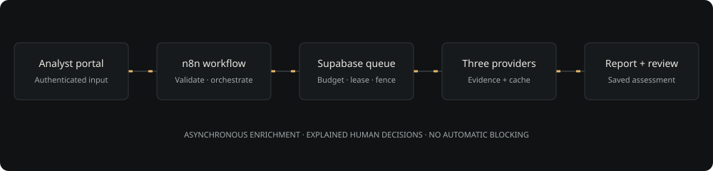
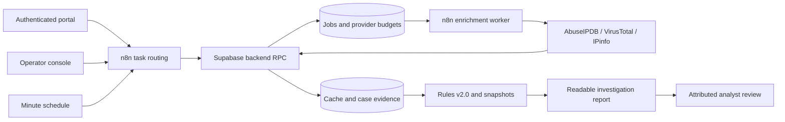

# IP Intelligence

### Evidence before action.

An IP investigation system built as **one n8n workflow**, with hosted Supabase persistence and three intelligence providers. It turns a submitted IP into attributable evidence, a versioned automated assessment, and a separate analyst decision.

**58 nodes · 3 providers · Reputation rules v2.0 · One unified workflow**

The deployed event-investigation release adds validated JSON import, duplicate suppression, event correlation, contextual priority and an investigation worklist. The authenticated upload, confirmation, report and explained-review flow has been verified in a real browser. See [event release guide](docs/EVENT_RELEASE.md).

[Event investigation guide](docs/EVENT_RELEASE.md) · [Animated documentation](docs/site/index.html) · [Architecture](docs/ARCHITECTURE.md) · [Setup](docs/SETUP.md) · [Operations](docs/OPERATIONS.md) · [Security](docs/SECURITY.md) · [Verification](docs/VERIFICATION.md)

> Live integrations and targeted acceptance tests have passed. Production throughput, independent security assurance, and disaster recovery remain validation milestones. See the verification guide for the scope of recorded evidence.



## The problem it addresses

An IP reputation lookup is easy. Making it useful in an investigation requires more: handling conflicting evidence, preserving observation dates, limiting API traffic, surviving provider failures, and recording who made the final decision.

This system brings those steps together. It does not treat a vendor flag as proof of malicious activity, and it does not automatically block an IP.

## What it does

- **Guided portal:** import security events, browse investigations, submit IPs, retrieve reports or record analyst reviews. Imports require a validation preview and explicit confirmation.
- **Controlled enrichment:** provider-specific jobs, a durable queue, deduplication, cached evidence, daily budgets, and retry cooldowns.
- **Three complementary sources:** AbuseIPDB for abuse reports, VirusTotal for vendor findings, IPinfo Lite for network context.
- **Explainable assessments:** isolated, conflicting, cross-source, incomplete, and outdated evidence have distinct outcomes.
- **Evidence history:** reports save assessment snapshots with the rule version and evidence used. Repeated reads reuse an unchanged snapshot.
- **Human review:** analyst dispositions and explanations are separate from automated findings. Reviewer identity comes from the authenticated n8n form session.
- **Operational controls:** provider enable/disable, metrics, retention, and an offline demonstration are available through the same workflow.

## Explore the animated docs

No build tools, external fonts, analytics, or JavaScript dependencies are required.

```bash
cd ~/ip-intelligence
python3 -m http.server 8080 --bind 127.0.0.1 --directory docs/site
```

Open **http://127.0.0.1:8080**. The docs include an animated pipeline walkthrough, an illustrative assessment explorer, searchable navigation, theme switching, and reduced-motion support. They are documentation, not a live operations dashboard.

## Architecture at a glance



One scheduled invocation claims at most one eligible provider job. Provider requests are budgeted at **100 per provider per UTC day**, with a **60-second provider cooldown**. A fresh three-provider investigation can take multiple schedule ticks; backlog and provider cooldowns can extend that time.

## A realistic decision example

A recorded investigation of `8.8.8.8` contained one VirusTotal vendor flag and an AbuseIPDB confidence score of zero. The current classifier records **conflicting evidence**, explaining that the isolated flag lacks corroboration from the current abuse confidence score. Neither the zero score nor the vendor majority establishes safety.

This is an example from a dated investigation, not a current verdict about that IP. An analyst must correlate the findings with observed activity and asset context.

## Get started

1. Create an n8n instance and a hosted Supabase project.
2. Read [SETUP.md](docs/SETUP.md), particularly the migration-history warning.
3. Import [the sanitized workflow](workflows/ip-intelligence-unified.sanitized.json).
4. Apply the database schema/migrations appropriate to the target environment.
5. Connect four n8n credentials and set the Supabase project URL.
6. Configure portal authentication, verify the isolated test paths, then publish.

The export deliberately has no credential bindings and no configured Supabase URL. Credential names, IDs, and secrets must be connected in the target instance. Native n8n user authentication availability depends on the installed n8n version and deployment.

## Analyst workflow

1. **Submit:** enter a public IP and an optional investigation reason. Save the investigation ID.
2. **Inspect:** retrieve the report; review source results, observation dates, cache status, coverage, and saved assessments.
3. **Decide:** record a disposition and supporting explanation through the case form.
4. **Close or continue:** closing requires a final disposition. The signed-in reviewer and assigned analyst remain separate concepts.

Available dispositions: **Under review**, **Confirmed malicious activity**, **Confirmed benign activity**, **Insufficient evidence**, and **Duplicate investigation**. Read the report first: a review must reference a saved assessment.

## Repository map

```text
.
├── README.md
├── docs/
│   ├── ARCHITECTURE.md
│   ├── DATA_MODEL.md
│   ├── RULES.md
│   ├── SETUP.md
│   ├── OPERATIONS.md
│   ├── SECURITY.md
│   ├── VERIFICATION.md
│   ├── ROADMAP.md
│   ├── assets/architecture.svg
│   └── site/                  # Local animated documentation
├── workflows/                 # Sanitized n8n import export
├── supabase/migrations/        # Database migration assets
├── tests/                     # Transactional SQL acceptance suites
├── test-results/              # Dated verification evidence
└── connect_supabase.py         # Local credential onboarding helper
```

## Verification and limits

Live tests exercised all three provider APIs, queue processing, duplicate requests, cached results, report retrieval, case closure, and scheduled execution. Failure responses were simulated inside n8n; lease recovery, quotas, snapshots, and review invariants were tested in rollback transactions. See [the test matrix](docs/VERIFICATION.md) for the exact boundaries.

Earlier workflow tests used simulated identities. The event release additionally passed an actual authenticated browser journey: JSON file upload, preview, confirmation, report, explained closure, review history and worklist. Anonymous GET and multipart POST were rejected. Synthetic demo cases remain clearly labeled; no human time-saving result is claimed.

## Development discipline

- Change the draft, validate affected nodes and paths, and publish the tested version.
- Keep migrations and exports alongside their verification evidence.
- Keep provider keys and the n8n public API key outside this repository.
- Do not commit n8n credential exports, database dumps, or browser-session data.
- Do not publish invented performance or accuracy numbers. Measure them first.

No third-party code from the referenced n8n MCP server is vendored. No open-source license is assumed or granted; choose a license before public distribution.
